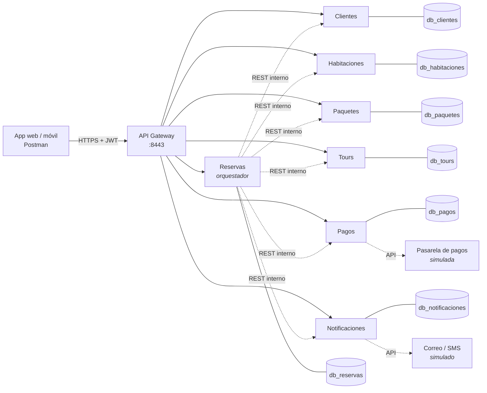

# JW Marriott Hotel Lima — Plataforma SOA

Backend de la **Plataforma de Reservas, Paquetes Turísticos y Tours** del Entregable 2
del curso *Arquitectura Orientada al Servicio* (UTP, sección 36321).

Implementa el diseño del entregable tal cual: siete servicios autónomos con contrato
REST, un **API Gateway** como único punto de entrada (HTTPS + JWT), una **base de datos
por servicio** y **Reservas** como servicio de proceso que orquesta a los demás.



## Levantarlo

Requisito: **Docker Desktop** (no hace falta instalar Java ni Maven: todo se compila
dentro de los contenedores).

```bash
docker compose up -d --build     # la primera vez tarda unos minutos (descarga dependencias)
docker compose ps                # los 9 contenedores en "Up"
```

La API queda en **https://localhost:8443/api/v1**. El certificado es autofirmado: en
Postman, *Settings → General → SSL certificate verification* en **OFF**; con `curl`, `-k`.

```bash
docker compose logs -f reservas notificaciones   # ver el flujo y los correos simulados
docker compose down                              # apagar (los datos se conservan)
docker compose down -v                           # apagar y borrar las bases (vuelve a los datos de ejemplo)
```

### Usuarios de demostración

| Usuario | Clave | Roles | Puede |
|---|---|---|---|
| `cliente` | `cliente123` | CLIENTE | registrarse, consultar el catálogo, reservar y cancelar |
| `recepcion` | `recepcion123` | ADMIN, CLIENTE | además, crear habitaciones, paquetes y tours, listar clientes y usar Pagos y Notificaciones directamente |

```bash
curl -k -X POST https://localhost:8443/api/v1/auth/token \
  -H 'Content-Type: application/json' -d '{"usuario":"cliente","clave":"cliente123"}'
# → {"access_token":"eyJ…","token_type":"Bearer","expira_en":3600,…}
```

## Probarlo

- **Postman:** importar `postman/JW-Marriott-SOA.postman_collection.json` y correrla
  con el *Collection Runner* (carpetas en orden). Son 32 solicitudes con 39 aserciones,
  incluidos los caminos de error (401, 403, 400, 404, 409, 402).
- **Script de punta a punta** (Git Bash, WSL, Linux o macOS): `./scripts/prueba-e2e.sh`.
- **Tests unitarios:**
  ```bash
  docker run --rm -v "$PWD":/src -w /src maven:3.9.9-eclipse-temurin-21 mvn -q test
  ```
  Cubren el orquestador (reserva confirmada, sin cupo, tour sin cupo, pago rechazado,
  referencias inválidas, cancelación), la pasarela, las reglas de acceso y el JWT.

## Servicios

| Servicio | Tipo | Recurso | Base | Depende de |
|---|---|---|---|---|
| Clientes | Entidad | `/api/v1/clientes` | `db_clientes` | — |
| Habitaciones | Entidad | `/api/v1/habitaciones` | `db_habitaciones` | — |
| Reservas | Proceso | `/api/v1/reservas` | `db_reservas` | Clientes, Habitaciones, Tours, Paquetes, Pagos, Notificaciones |
| Paquetes | Entidad | `/api/v1/paquetes` | `db_paquetes` | — |
| Tours | Entidad | `/api/v1/tours` | `db_tours` | — |
| Pagos | Utilidad | `/api/v1/pagos` | `db_pagos` | pasarela externa (simulada) |
| Notificaciones | Utilidad | `/api/v1/notificaciones` | `db_notificaciones` | proveedor de correo/SMS (simulado) |

Solo el gateway publica un puerto. Los servicios y PostgreSQL viven en la red interna de
Docker (`backend`); PostgreSQL se abre en `127.0.0.1:5433` solo para inspeccionarlo con
pgAdmin o DBeaver (usuario y clave `marriott`).

### Endpoints

| Método | Endpoint | Qué hace | Códigos |
|---|---|---|---|
| POST | `/auth/token` | Emite el JWT | 200, 401 |
| POST | `/clientes` | Registra un cliente | 201, 400, 409 |
| GET | `/clientes/{id}` | Obtiene un cliente | 200, 404 |
| PUT | `/clientes/{id}` | Actualiza sus datos | 200, 400, 404, 409 |
| GET | `/clientes?email=` | Lista o busca por correo (ADMIN) | 200 |
| GET | `/habitaciones?desde&hasta&tipo` | Disponibilidad (sin fechas: inventario) | 200, 400 |
| GET | `/habitaciones/{id}` | Detalle | 200, 404 |
| POST | `/habitaciones` | Crea una habitación (ADMIN) | 201, 400, 409 |
| POST | `/habitaciones/{id}/bloqueo` | Bloquea el cupo para una reserva | 200, 404, 409 |
| DELETE | `/habitaciones/bloqueos/{reservaId}` | Libera el cupo de una reserva | 200 |
| POST | `/reservas` + `Idempotency-Key` | Reserva integrada | 201, 400, 402, 409 |
| GET | `/reservas/{id}` | Consulta una reserva | 200, 404 |
| GET | `/reservas?cliente_id=` | Reservas de un cliente | 200 |
| DELETE | `/reservas/{id}` | Cancela (libera, devuelve cupo y reembolsa) | 200, 404, 409 |
| GET | `/paquetes?activo&precio_max&q` | Lista con filtros | 200 |
| GET · POST · PUT · DELETE | `/paquetes[/{id}]` | CRUD (escrituras ADMIN; DELETE desactiva) | 200, 201, 400, 404 |
| GET | `/tours?fecha` | Tours con cupo esa fecha (sin fecha: los próximos) | 200 |
| GET · POST | `/tours[/{id}]` | Detalle y alta (ADMIN) | 200, 201, 404 |
| POST | `/tours/{id}/reserva` | Reserva cupo en un tour | 201, 404, 409 |
| POST | `/pagos` | Cobra (ADMIN; lo usa Reservas) | 200, 402 |
| POST | `/pagos/{txnId}/reembolso` | Reembolsa | 200, 404, 409 |
| POST | `/notificaciones` | Encola un correo o SMS (ADMIN; lo usa Reservas) | 202 |
| GET | `/notificaciones/{id}` | Estado del envío | 200, 404 |

Convenciones (sección 2 del entregable): JSON UTF-8 con nombres en `snake_case`,
versión en la ruta (`/api/v1`), `Authorization: Bearer <token>` en todo salvo
`/auth/token`, y fechas con zona de Lima (`2026-10-07T09:00:00-05:00`). Todos los
errores tienen la misma forma:

```json
{ "error": "SIN_DISPONIBILIDAD",
  "mensaje": "La habitación HAB-301 no tiene cupo en el rango solicitado.",
  "sugerencias": ["HAB-305", "HAB-410"] }
```

## La reserva integrada, paso a paso

`POST /api/v1/reservas` (ejemplo de la sección 3.3; total = 920 × 3 noches + 380 = 3140):

1. **Valida** fechas, cliente activo, habitación, tour (dentro de la estadía) y paquete
   (activo). Solo lecturas: si algo falla, 400 y no se toca nada.
2. **Crea la reserva PENDIENTE**, para tener el id con el que la referencian los demás.
3. **Bloquea la habitación** (Habitaciones). Sin cupo → 409 con sugerencias del mismo tipo.
4. **Reserva el tour** (Tours). Sin cupo → se libera la habitación y 409.
5. **Cobra** (Pagos). Rechazado → se devuelve el cupo del tour, se libera la habitación y 402.
6. **CONFIRMADA** y aviso por correo (Notificaciones). El aviso es de mejor esfuerzo: si
   Notificaciones no responde, la reserva igual queda confirmada.

No hay transacción distribuida: cada paso hecho se deshace con su **compensación**
(patrón Saga orquestada). La reserva que no se completa queda **CANCELADA** con el
`motivo`. Ciclo: `PENDIENTE → CONFIRMADA → CANCELADA`.

**Contra la sobreventa:** el bloqueo toma la fila de la habitación con un candado de
escritura (`SELECT … FOR UPDATE`) antes de mirar los cruces de fechas, y el cupo de los
tours se descuenta con un `UPDATE … WHERE cupo_disponible >= n` atómico. Dos clientes
que piden lo último a la vez: uno entra y el otro recibe 409.

**Contra las reservas duplicadas:** la `Idempotency-Key` es obligatoria. La misma clave
con el mismo cuerpo devuelve la respuesta guardada (201, 402 o 409, con la cabecera
`Idempotent-Replayed: true`) sin volver a bloquear ni a cobrar; con otro cuerpo, 409. Si
lo que falló fue otro servicio (503), la clave se libera para poder reintentar.

**Pasarela simulada** (no sale a internet): `tok_rechazo…` → tarjeta rechazada,
`tok_sin_fondos` o más de S/ 20,000 → fondos insuficientes, cualquier otro `tok_…` →
aprobado. Del token solo se guardan los últimos 4 caracteres.

## Datos de ejemplo

Al arrancar, cada servicio carga los suyos (solo si no existen):

- **Cliente** `CLI-000123` (Mario Iván Aponte Matos, el del contrato).
- **Habitaciones:** `HAB-101`, `HAB-102` (simple, S/ 420), `HAB-201`, `HAB-202` (doble,
  S/ 580), `HAB-205` (doble, en mantenimiento), `HAB-301`, `HAB-305` (suite, S/ 920),
  `HAB-410` (suite, S/ 950), `HAB-501` (presidencial, S/ 2,400).
- **Tours:** `TOU-012` City tour Lima Colonial (2-nov-2026, S/ 380), `TOU-013`
  Pachacamac, `TOU-014` Islas Palomino, `TOU-015` (agotado, para probar el 409), `TOU-016`.
- **Paquetes:** `PAQ-001` a `PAQ-003` activos y `PAQ-004` inactivo.

## Tecnologías (sección 6)

Java 21 + Spring Boot 3.3 (Spring Web, Data JPA, Validation, Actuator) en cada
servicio; Spring Cloud Gateway con JJWT (HS256) en el gateway; PostgreSQL 16 con una base
por servicio y sin claves foráneas entre bases (las referencias son ids lógicos);
Docker + docker compose, con una imagen por servicio; Postman/Newman para la evidencia.

## Estructura

```
├── pom.xml                      POM padre: solo versiones comunes
├── docker-compose.yml           despliegue (Figura 3)
├── docker/
│   ├── service.Dockerfile       imagen de cada servicio (--build-arg MODULE=…)
│   └── postgres/init.sql        crea las 7 bases
├── gateway/                     API Gateway: rutas, HTTPS, JWT y roles
├── services/
│   ├── clientes/  habitaciones/  paquetes/  tours/
│   ├── reservas/                orquestador: servicio/OrquestadorReservas.java
│   └── pagos/  notificaciones/
│       └── src/main/java/pe/utp/marriott/<servicio>/
│           ├── api/             controlador y contratos (request/response)
│           ├── servicio/        reglas de negocio
│           ├── modelo/          entidades y repositorios (su propia base)
│           ├── error/           formato común de errores
│           └── comun/           ids legibles y zona horaria
├── postman/                     colección de evidencia
└── scripts/prueba-e2e.sh        recorrido completo por el gateway
```

Cada servicio es un proyecto Maven independiente: se construye, versiona y escala por
separado (`docker compose up -d --build reservas` reconstruye solo Reservas;
`docker compose up -d --scale habitaciones=2` replica uno en temporada alta).

## Configuración

Todo tiene un valor por defecto para el entorno académico. Para cambiarlo, copiar
`.env.example` a `.env`. En un entorno real hay que cambiar como mínimo `JWT_SECRET`,
las claves de la base y las de los usuarios, y montar un certificado real en el gateway
(`SSL_KEYSTORE`).

## Integrantes

Aponte Matos, Mario Ivan · Rosas Tamara, Walter Alexander · Chava Mendoza, Fernando ·
Mendoza Malca, Mayco · Jaramillo Rojas, Moisés Alonso · Tabaco Perez, Luis Jayson

Docente: Lázaro Gómez, Jack Paul — Lima, 2026
